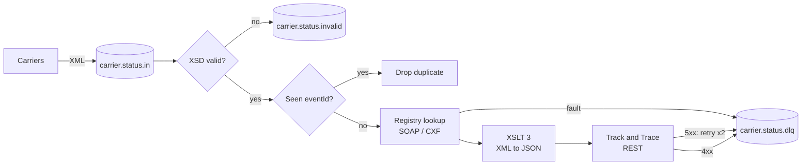

# Fuse 7 to Camel 4 migration

A logistics integration as it runs on **Red Hat Fuse 7** (Camel 2.23, Blueprint, Karaf), migrated to **Camel 4 on Quarkus** for **OpenShift**, with golden-file scenarios that prove both versions behave the same.

Fuse 7 is out of support since June 2026. This repository shows a migration approach that is safe because it is measurable: the old and the new implementation run the same scenarios, and the build fails if they differ.

## The integration

Carriers publish shipment status events. The integration validates them, looks up the shipment in a SOAP registry, maps them to the canonical event and delivers them to the Track and Trace API.



## Repository layout

| Path | Contents |
| --- | --- |
| `legacy-fuse7/` | The starting point: an OSGi bundle with a Blueprint XML route, Config Admin, AMQ 7 client, CXF and http4, on Fuse 7.13 versions |
| `modern-quarkus/` | The result: the same routes in Camel 4 XML IO DSL on Quarkus, CDI beans, MicroProfile Config, health probes and Prometheus metrics |
| `test-scenarios/` | Golden files: input messages, registry responses and the expected Track and Trace request or queue outcome |
| `scenario-harness/` | Test support used by both implementations: loads the scenarios and simulates the registry and Track and Trace with WireMock |
| `contracts/` | Carrier XSD and registry WSDL, unchanged by the migration |
| `openshift/` | Kustomize manifests: Deployment with probes, ConfigMap, Service, ServiceMonitor; `overlays/dev` for a local cluster |
| `docs/MIGRATION.md` | The migration guide: approach, mapping tables, pitfalls found along the way, cutover plan |

## Scenarios

| Scenario | Expected behaviour |
| --- | --- |
| `delivered-on-time` | Delivered before the promised date: event sent with `onTime: true` |
| `delivered-late` | Delivered after the promised date: `onTime: false` |
| `in-transit` | Carrier code `TRN` mapped to `IN_TRANSIT`, no `onTime` |
| `duplicate-event` | Same event twice: forwarded once |
| `invalid-message` | Fails XSD validation: invalid queue, nothing sent |
| `unknown-shipment` | Registry SOAP fault: dead letter queue, no retry |
| `tracktrace-unavailable` | Track and Trace `503`: three attempts, then dead letter queue |
| `tracktrace-rejects` | Track and Trace `422`: no retry, dead letter queue |

Both implementations pass all eight. The XSLT mappings are identical in both, checked by CI.

## What the migration surfaced

The scenarios caught a real behaviour change: Camel 4's `http` component uses Apache HttpClient 5, which retries `503` responses on its own. On top of the Camel redelivery policy, Track and Trace received six calls instead of three. The details, and the other pitfalls (Java EE modules removed from the JDK, Aries Blueprint on Java 21, Camel Quarkus extensions), are in [docs/MIGRATION.md](docs/MIGRATION.md).

## Build and test

Requirements: JDK 21 (the legacy module also builds on JDK 11) and Maven 3.9. No Docker needed for the tests: they start an embedded Artemis broker and WireMock.

```bash
mvn verify                                      # everything
mvn -pl scenario-harness,legacy-fuse7 -am verify    # Fuse 7 scenarios only
mvn -pl scenario-harness,modern-quarkus -am verify  # Camel 4 scenarios only
```

## Run on OpenShift

```bash
mvn -pl scenario-harness,modern-quarkus -am package -DskipTests
docker build -f modern-quarkus/src/main/docker/Dockerfile.jvm -t ghcr.io/itqaanconsulting/shipment-status modern-quarkus
docker push ghcr.io/itqaanconsulting/shipment-status

oc new-project logistics-dev
oc create secret generic shipment-status-amq \
  --from-literal=JMS_USERNAME=<user> --from-literal=JMS_PASSWORD=<password>
oc apply -k openshift/overlays/dev
```

Configuration lives in the `shipment-status-config` ConfigMap; every key in `application.properties` can be overridden there as an environment variable (`registry.url` becomes `REGISTRY_URL`). Health: `/q/health/live`, `/q/health/ready`, `/q/health/started`. Metrics: `/q/metrics`, scraped through the ServiceMonitor.

## Technology

| | Fuse 7 (legacy) | Camel 4 (modern) |
| --- | --- | --- |
| Runtime | Karaf / OSGi, Java 11 | Quarkus 3.40, Java 21 |
| Camel | 2.23 (Blueprint XML) | 4.22 (XML IO DSL) |
| Messaging | AMQ 7 client, `javax.jms` | Artemis client, `jakarta.jms` |
| SOAP | camel-cxf (CXF 3.2) | camel-quarkus-cxf-soap |
| HTTP | camel-http4 | camel-quarkus-http (HttpClient 5) |
| XSLT | Saxon-HE 9.8 | Saxon-HE 13 |
| Configuration | Config Admin | MicroProfile Config, ConfigMap |
| Operations | Hawtio, JMX | Health probes, Prometheus, OpenShift |
